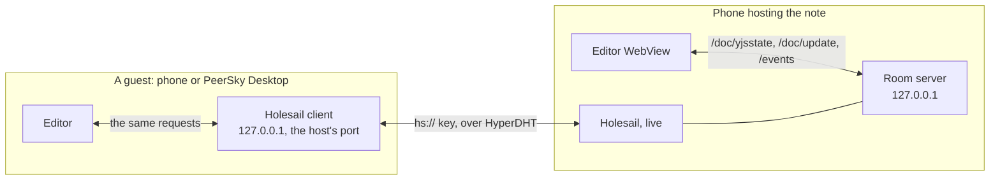

# P2PMD (mobile)

PeerSky Mobile includes a P2PMD implementation that runs from the Bare worklet and exposes a local HTTP editor server. The goal is to support collaborative Markdown editing over Holesail while keeping the mobile app shell thin.

This mirrors the desktop direction at the protocol level: local HTTP endpoints expose document state, peers connect through an event stream, and Yjs carries collaborative document updates.

## Features

- Say what P2PMD is the first time it opens, once per phone (`AppWelcome`, marker `p2pmd-welcome-seen`).
- Start a local P2PMD HTTP server on loopback.
- Create or join a Holesail-backed room.
- Serve the mobile Markdown editor through WebView.
- Store document content in a Yjs document.
- Accept full document writes and incremental Yjs updates.
- Send each edit to everyone over SSE as the Yjs change it made, the moment it lands. The whole note and the people list go out a few times a second rather than with every keystroke (see [How many people a note holds](#how-many-people-a-note-holds)).
- Track peer presence and non-host peer count.
- Track line attribution metadata used by gutter marks.
- Open the tab list from the note's header, as the browser toolbar does. The host or client tag sits beside the note's local address.
- Render Markdown preview with raw HTML disabled.
- Rewrite Hyper image URLs in preview through the local Hyper file proxy.

## Main endpoints

| Endpoint | Method | Purpose |
|---|---|---|
| `/` or `/index.html` | `GET` | Mobile editor page |
| `/status` | `GET` | Runtime status and peer list |
| `/activity` | `GET` | Recent edits by peer, for the room's activity list |
| `/doc` | `GET` | Current document state |
| `/doc` | `POST` | Full document update |
| `/doc/yjsstate` | `GET` | Full Yjs state for initial sync |
| `/doc/update` | `POST` | Incremental Yjs update |
| `/presence` | `POST` | Peer cursor and line attribution metadata |
| `/events` | `GET` | SSE stream for peers, document updates, and peer list |
| `/hyper/file` | `GET` | Read Hyper file content for preview assets |

Previews are rendered by the app through its own bridge, not by the room's server.

Everything but the editor page needs the room's token for this run, as `token=` in the address or, from the note's tunnel, an `X-PeerSky-Token` header. Without it the server answers `403` and reads or changes nothing.

## Runtime flow

1. React Native sends an RPC command to create or join a P2PMD room.
2. The Bare backend starts the local P2PMD HTTP server on `127.0.0.1`.
3. Holesail exposes or connects the local server through an `hs://` key. Each note keeps one port, as on the desktop: the host reopens it on the port it had before, and a phone that joins listens on the port it used for that note last, or else the one the host advertises. If that port is taken on the phone, or is one another server in the app keeps (PeerTunes' 47317), the system picks one instead. The ports are kept in `hyper-sdk/p2pmd-ports.json`, for the thirty notes used last.
4. The WebView shows the app's own editor page, with the room's local address as its base.
5. The editor loads initial state from `/doc/yjsstate`.
6. Local edits are sent to `/doc/update` as Yjs updates.
7. Remote updates arrive through `/events` and are applied in the editor.
8. Presence updates keep peer counts and gutter attribution metadata in sync.

The editor sends two sets of line authors with each edit: `lineAttributions`, everyone's lines as it knows them, which the phone's own host keeps for the note, and `peerLineAttributions`, the lines this person wrote. A host files only the second under the sender. The desktop host used to take the first as the phone's own, so a phone in a note hosted on a desktop showed everyone's lines as written on it.

The host's server holds the document. A guest's editor makes the same requests
to its own Holesail client, which carries them to the host.

Any app on the phone can reach both ports, so both answer only requests that
carry a token the app gives its editor WebView before the page loads
(`injectedJavaScriptBeforeContentLoaded`, `app/server-token.mjs`). The editor
adds it to every request. On the host, the server makes a token each run, and
the Holesail side puts it on the first request of each connection from someone
who came in with the note's address (`backend/holesail/request-gate.mjs`). On
a guest, the local port lets through only requests with the guest's own token
and takes it out before they go on, so the host never sees it. Nothing about
the token crosses the wire, so older phones and the desktop are unaffected.

## How many people a note holds

A note is meant for a team, up to about 100 people. Every editor talks to the host, so the host's upload is what limits a room:

- An edit goes to everyone as the change it made, never as the whole note.
- The people list (who is here, where their cursor is, who wrote which line) goes out four times a second, and less often in a big room: once a second at 100 people. Joins and leaves go out at once.
- A person's line authors are in that list only when they changed since the last one. Someone who joins gets everyone's in full.
- The whole note as text, which the editor reads line authors from, goes out at most twice a second, and every two seconds at 100 people.

`npm run test:load:p2pmd` measures this on one machine: this phone's room server under Node, with simulated editors that make the same requests as the real ones (see [test/load/p2pmd](../test/load/p2pmd/README.md)). PeerSky Desktop has the same test for its host. Run on 2026-10-12 on a MacBook Air (Apple M5, 10 cores, 32 GB, Node 24.21), each typist typing a character every 100 ms on a line of their own:

| 100 people, 10 typing for 60 s | Phone host, desktop editors | Phone host, phone editors | Desktop host, desktop editors | Desktop host, phone editors |
|---|---|---|---|---|
| Edits sent, none refused | 5,977 (100 a second) | 5,971 (100 a second) | 5,950 (99 a second) | 5,942 (99 a second) |
| Every editor ended with the host's text | yes | yes | yes | yes |
| Time until every editor saw an edit (median, slowest) | 3 ms, 7.1 ms | 66.3 ms, 89.1 ms | 2.5 ms, 5.4 ms | 59.7 ms, 85.4 ms |
| Data in per editor | 44 KB/s | 44 KB/s | 33 KB/s | 32 KB/s |
| Out from the host | 4.5 MB/s | 4.4 MB/s | 3.4 MB/s | 3.3 MB/s |
| Host CPU, first and last 5 s | 14%, 10% | 13%, 10% | 13%, 10% | 12%, 8% |
| Host memory at most | 173 MB | 173 MB | 139 MB | 137 MB |
| Yjs state at the start and end | 8.6 KB, 73.2 KB | 8.6 KB, 116.9 KB | 2.4 KB, 12.1 KB | 2.4 KB, 12.1 KB |

Data in counts the replies to an editor's own requests too, and out from the host counts headers, so these run higher than earlier measurements of the events alone. The phone editor applies what the host sends every 80 ms, which sets its times. Until 0.1.3 the phone host did more for each edit: it tried the edit on a copy made from the note's whole Yjs state and answered with the whole note, so its CPU climbed while people typed (from 19% of a core to 30% with desktop editors and 43% with phone editors over this minute), and a phone editor's edit set every line's author again (at 20 people with 3 typing the Yjs state reached 395 KB in 20 seconds, against 18 KB now). Now it tries each edit on a copy kept in step with the note and answers with ok alone, as the desktop host does, so an edit costs the same however long the note has been edited. Sending the whole note and the people list with every keystroke, as P2PMD once did, was 4.3 MB a second to each device and 426 MB a second from the host.

A note is live only while its host has it open. iOS suspends PeerSky a few minutes after it leaves the screen, and a note the phone hosts goes offline with it until it comes back; edits made meanwhile merge then. The phone saves the note's Yjs history with its copy, so even after PeerSky was closed, the note opens again with the history its editors share, and their edits merge into it instead of the note being written out twice. For a big or long-running room, host from a desktop.

## Private and public notes

Create Note asks one thing: private or public. Every new note starts private, the same as on the desktop. The desktop's UDP, host and port options are left off the phone.

- **Private**: the key is a secret the host's keys are made from, so finding the note on the network lets nobody in. Only people you send the key to can open it, and any of your devices can host it from its copy.
- **Public**: the key is the host's public key. Anyone with it can open the note, and the DHT nodes that store its announcement have it. Hosting from that key would make a different note, so the phone keeps the seed each public note came from in `hyper-sdk/p2pmd-public-notes.json` (the thirty used last) and reopens it from there. Link Device never sends the seed, so only this phone can host the note, and other devices get it as one to join.

## Safety notes

- The editor runs only the app's code. yjs ships inside the page, so whoever hosts a room sends data, never scripts.
- The editor WebView loads nothing but the editor. Links in a note open in a browser tab, and other apps are never opened from it.
- The app acts on editor messages only when they come from the editor page, and publishes only with a nonce it handed over when you tapped Publish.
- The room's server answers the editor and desktop P2PMD (`peersky://p2p`), and turns away pages on any other origin, other loopback servers included.
- The room's server and a joined note's local port answer only requests with this run's token, compared in constant time, so another app on the phone that finds the port can neither read nor edit the note.
- The local server binds to loopback only.
- Android cleartext HTTP is scoped to localhost/127.0.0.1 through network security config.
- Raw HTML is disabled in Markdown preview because preview HTML is injected into the page.
- Document and update sizes are bounded to reduce memory abuse risk.
- Holesail server/client hosts are restricted to loopback so the app does not become a LAN relay.

## Test coverage

P2PMD coverage lives under `test/protocol/`:

- `p2pmd-document.test.mjs` covers Yjs document state, update validation, full-state sync, and subscriber behavior.
- `p2pmd-http.test.mjs` covers the real HTTP endpoint contract with an injectable Node HTTP server, including edits going out at once while the whole note and the people list are paced, and every endpoint but the editor page refusing a request without the run's token.
- `note-tunnel.test.mjs` carries notes over a local DHT, with Holesail on the other end too, and checks that the token gets the editor through both ends, keeps other apps out, and never reaches the other device.
- `p2pmd-peers.test.mjs` covers peer counting, disconnect pruning, gutter line ownership, and line authors going out again only when they change.
- `p2pmd-preview.test.mjs` covers Markdown rendering and Hyper image URL rewriting.

`test/platform/p2pmd-workspace-header.test.mjs` covers the tabs button in the note's header.

The endpoint tests include desktop-inspired collaboration flows where peers disconnect, continue editing, and reconnect while document state is preserved.
