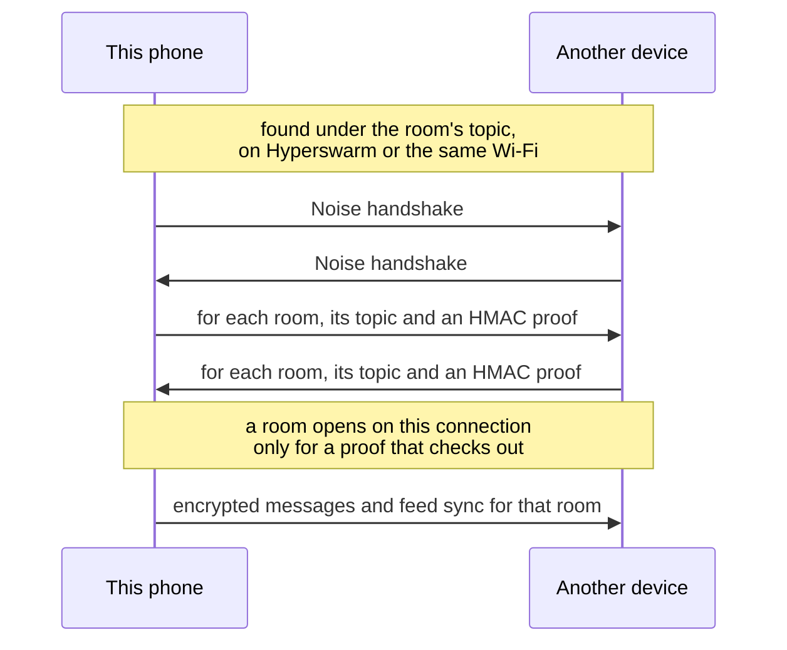

# PeerChat on mobile

PeerChat provides end to end encrypted peer-to-peer group rooms and direct
messages at `peersky://p2p/peerchat/`. There are no accounts and no servers, and
rooms keep working on a local network without internet. The mobile
implementation uses the same room-key, topic, room-proof, message-encryption,
and transport formats as PeerSky Desktop.

## Capabilities

- Create a group or join one with its 64-character room key or an invite link,
  which says who made the room too.
- Exchange encrypted messages with mobile and desktop peers.
- Rooms and direct messages made on 0.1.2 or later change their message key
  every hour, so a key someone gets later cannot read what came before.
- Every message is signed by whoever wrote it, and passed on from device to
  device, so it reaches people its author is not connected to and nobody can
  fake one.
- Restore recent rooms and message history after an app restart.
- Keep a chat per browser tab, so two tabs show two rooms, each tab named after
  its room. The tab's chat is kept in PeerChat's UI state, not in its address,
  so no room key sits in the address bar.
- Reply to messages, add reactions and mention peers. Tapping the quote in a
  reply goes to the message it answers, loading older history first if needed.
- Search inside a chat, or from the chat list: chats whose name matches, then
  matching messages from every chat, kept on this phone and never asked of
  anyone else (see [Search](#search)).
- Back-to-back messages from one person show together under one name, closer
  together, with the time once at the end of a run. A gap of five minutes, a
  new day, or a notice in between starts a new group, the same rule as the
  desktop (`app/peerchat/message-groups.mjs`).
- Share room-encrypted Hyperdrive attachments and bounded HTTP or HTTPS link
  previews. A picture or video's bubble fits it, and either can be saved from
  the viewer or its long-press menu: on iOS through the share sheet, on Android
  into a folder picked once, so no new permission is asked for.
- Forward messages, pictures, videos and files to another chat, each marked
  Forwarded. Several go a moment apart, under that chat's spam limit, and a
  picture or video forwarded into a group is screened like one sent there.
- Start direct-message conversations through an explicit accept or decline flow.
- Take pages from the browser's Send to Your Devices into your chat with
  yourself. With no such chat yet, one is started with another of your devices
  and the page waits, in memory, until that device accepts it, which it does by
  itself as soon as it is online.
- Set a profile, and as the person who made a room, its name, description,
  link, picture and moderation, then change them later with Edit room.
  Everyone in the room takes the change, signed by the room's creator (see
  [Room details, signed by whoever made the room](#room-details-signed-by-whoever-made-the-room)).
- Pin or mute rooms and track unread messages and mentions.
- Show online room members and reconnect after temporary network loss.
- Notify for unread messages while the PeerSky process can receive events.

## Architecture

The React Native screen sends bounded commands over the existing `bare-rpc`
bridge. A single `PeerChatService` in the Bare worklet uses PeerSky's shared
`hyper-sdk` runtime for public and local-network discovery. It does not open a
second SDK, Corestore, swarm, local HTTP server, or unrestricted proxy.

Each room derives a discovery topic and an AES-256-GCM message key from separate
contexts. A room made on 0.1.2 or later seals its messages with hourly keys
instead (see [Keys that rotate](#keys-that-rotate)). The room key itself is never used as the public discovery topic, and
it never goes over the wire either: frames name a room by its topic, and a peer
is let into a room on a connection only after it proves it holds the key. Every
received frame, profile field, URL, attachment description, timestamp, and
persisted record is normalized and bounded before use.

Important files:

- `app/peerchat/PeerChatScreen.tsx`: mobile room list, chat UI, and actions.
- `backend/peerchat/service.mjs`: rooms, feeds, synchronization, and lifecycle.
- `backend/peerchat/protocol.mjs`: validation, key derivation, and encryption.
- `backend/peerchat/room-proof.mjs`: the proof a peer gives that it holds a room's key.
- `backend/peerchat/key-chain.mjs`: hourly message keys for rooms made on 0.1.2 or later.
- `backend/peerchat/removal-signature.mjs`: the creator's signature on a room's removal list.
- `backend/peerchat/room-move.mjs`: room keys that say who made the room, and a room's move to a new key when somebody is removed.
- `backend/peerchat/message-signature.mjs`: every message's signature by whoever wrote it.
- `backend/peerchat/transport.mjs`: bounded newline-delimited peer frames.
- `backend/peerchat/link-preview.mjs`: bounded public-network preview fetching.
- `backend/peerchat/moderation.mjs`: local content and spam enforcement.
- `backend/peerchat/runtime.mjs`: shared-runtime service initialization and cleanup.

## Moderation

Each phone and desktop filters what it sends and what it receives, on its own.
In a group, a message with threats, slurs or an adult-domain link is held back
and a notice takes its place. So is a file whose name has them, since the name
shows in the chat list, a search and a notification. A picture that looks
explicit is refused before it is sent. A direct message skips the text filters,
file names included: it is between two
people, and either can block the other. The spam limit still applies there, and
a picture that looks explicit arrives hidden behind a warning the reader can
open. Whether a room is a direct message is worked out on each device, never
taken from a peer, so no room setting can switch a group's filters off.

Whoever made a room can remove anyone from it, for good. The creator signs the
room's removal list with their own key, so anyone in the room can pass it on
and every device checks it against the creator's key, which is how a removal
reaches people who never meet the creator. A list from an older build carries
no signature and counts only from the creator's own connection. On 0.1.3 the
room also moves to a new key for the people still in it (see
[Removing somebody moves the room](#removing-somebody-moves-the-room)). A
person's other devices are members of their own, so each has to be removed.

The picture check runs the vendored model in a hidden WebView
(`app/media/NsfwScanner.tsx`). iOS ends a WebView's page process while the app
is in the background, and Android can lose its renderer, so the page is loaded
again when that happens, and a picture goes to the page only once it says it is
ready. The chat says it is checking a picture while it does. The small JPEG it
makes of each picture is deleted once read, and Clear all P2P data, Remove my
data and a restore delete the copies Save and Share made
(`clearChatFileCopies` in `app/peerchat/media-save.ts`).

## Room-key security

The room key is both an invitation and, in a room made before 0.1.2, the secret
needed to decrypt its messages. Anyone who receives it can join that room and
read synchronized history, all of it in an older room and from the hour they
join in a newer one, so share it only with intended participants. PeerChat has
no server-side account or invitation revocation. Removing somebody from a room
moves it to a new key for the people still in it, so invites from before stop
working; a device on 0.1.2 or older stays on the old key. For a key exposed
some other way, create a new room and share its key.

A room's discovery topic is public: DHT nodes see it on the way past, so knowing
it opens nothing. On every connection each side sends, for each of its rooms,
the topic and an HMAC-SHA256 keyed with `SHA-256("peersky-chat:proof:" +
roomKey)` over `"peersky-chat/2 room\n" + handshakeHash + "\n" +
senderPublicKey`, both as hex. The Noise handshake hash is the same at both ends
of one connection and different on every other, and the sender key is the one
that handshake proved, so a proof cannot be replayed elsewhere or bounced back.
A room opens to a peer only when its proof checks out, and this phone sends its
own proofs before anything about a room, so its join never arrives first. Being
found under a room's topic, or naming the room in a frame, counts for nothing.
The desktop makes the same proof, and both pin one test vector.



The chat channel is `peersky-chat/2`. Version 1 sent the room key to anyone who
turned up under a room's topic, so a room used with a version 1 build that has
to stay private is worth recreating. The two versions do not open a channel
with each other.

A direct message's key is the one key that crosses the wire, inside the invite,
to the one person it is for. It goes to their full public key, recorded when the
conversation starts and checked on every answer, never to the 8-character peer
id, which is short enough to grind. A personal link or QR code carries the full
key, so a request from one goes to that key alone. A request started from a
member list, or from an older link with only the 8-character id, goes to the one
connected key with that id, and while two share it, the invite waits.

### Keys that rotate

Rooms and direct messages made on 0.1.2 or later seal each hour's messages with
a different key, so a key someone gets later, from a forwarded invite or a lost
phone, cannot read anything sent before it. The room key marks such a room by
itself: `SHA-256("peersky-chat/3 rotates:" + roomKey)` starts with two zero
bytes, which a new room's key is picked to meet. An older room can never be
given a chain, so it seals with its room key as before and every version reads
it.

- Hours count from the Unix epoch. The chain starts with 32 random bytes, made
  by whoever made the room or opened the direct message, for the hour it was
  made.
- The next hour's secret is `HMAC-SHA256(secret, "peersky-chat/3 next hour")`,
  which cannot be run backwards, and an hour's message key is
  `HMAC-SHA256(secret, "peersky-chat/3 message key")`.
- A message carries its hour as `e`. One without `e` was sealed with the room's
  message key, by an older build or by a device that has no chain yet, and still
  reads.
- On each connection, after a room's details and before its history, a device
  sends `room-chain` with the current hour and its secret, never an earlier one
  and never to someone removed. A phone takes one only when it has none and only
  for an hour from two before its own to one after, keeps it, and passes it on to
  the others in the room. It keeps the earliest secret it was given, so its own
  history stays readable on it.
- A file in such a room is sealed with a `fileKey` of its own, 32 random bytes
  used where the room key would be, and the `fileKey` travels inside the
  encrypted message.
- Link Device carries the chain with each room, and a device keeps the earliest
  start of the same chain.

It protects the past, not the future: every later hour's key follows from any
hour's, so a stolen phone keeps reading new messages until the room is replaced
with a new one, which removing it from the room now does (see below). Builds
from before 0.1.2 cannot read rooms made on 0.1.2 or later. The desktop keeps
the same rules in peerchat's `lib/key-chain.js`, and both apps pin one vector
(`test/protocol/peerchat-key-chain.test.mjs`).

### Signed messages and passing on

A message used to name its author in a field anyone could fill in. Straight
from its author, the connection proved who that was, but history a peer sent on
carried whatever author that peer wrote in. Now every message and reaction
carries:

- `ak`: the author's network key, whose first 8 hex are their id.
- `h`: a header the author writes once, as a JSON string: the room's topic,
  the message id, its time, its hour in a room whose keys rotate, the author's
  name, whether it was forwarded, and in an older room the reply and file
  details, which sit next to the sealed body there.
- `as`: an Ed25519 signature by `ak` over a label, `h` and the sealed body.

The phone keeps `h` exactly as it came, so a message can go on to the next
device and be checked there again. A signed message counts from anyone once its
signature checks out and its key is the one that id's connections proved. An
unsigned one, as an older build sends, counts only straight from its author's
connection, and never in somebody else's history.

A device opens up to 64 connections itself (Hyperswarm's default, which
PeerSky keeps), and others can connect to it too, so in a big room it ends up
with about a hundred. Even so, in a room of hundreds or thousands most people
are not connected to most others. A newer build says so in its handshake
(`pass: true`) and passes each new signed message on once to everyone else in
the room who said the same, never back where it came from or to its author. A
copy the phone has already seen stops at its first check, so a message crosses
the room in a few steps. Only signed messages are passed on, only for ten
minutes after they were written, and none from before the phone joined; an
older build never gets one.

Ids first. Passing the whole message on every connection meant a device took
in a copy from each of its connections, about a hundred in a big room. On 0.1.3
a device whose handshake also says `have: true` is sent only the id of each new
message, in a batch every 50 ms (`{ type: "have", room, ids }`). It asks for the
ones it does not have (`{ type: "want", room, ids }`) from the first neighbour
that told it, and that neighbour sends the message as a `pass`. If it has not
come in three seconds, the next neighbour that has it is asked, for up to 30
seconds. So a device takes in each message once, and a short id from its other
connections. Asked-for messages are kept outside the budget for unasked ones,
each connection has a budget of 6,000 ids a minute each way, and an older build
is passed whole messages as before. A device waits on at most 4,096 ids at
once, and of those one connection may have put 512 there and one room 2,048,
so made-up ids from one connection, or one busy room, cannot crowd out a real
message from another room.
Limits count per author, not per connection: each author has the room's spam
limit and 120 messages a minute, wherever their messages come from, so a device
passing on a busy room is never blamed for what others wrote. The desktop keeps
the same rules in peerchat's `lib/message-signature.js`, and both apps pin one
vector (`test/protocol/peerchat-message-signature.test.mjs`).

Messages are encrypted before they are appended to a room feed or sent to a
peer. Sender names, timestamps, reactions, and other routing metadata are not
promised to be anonymous. Peer discovery can also reveal network metadata to
the underlying P2P stack.

Room keys, profile information, recent-room metadata, and local preferences are
stored in the app-private PeerSky data directory, which is kept out of iCloud,
computer and Google backups and out of Android's phone-to-phone copy. The current
mobile build does not protect room keys with Android Keystore or iOS Keychain
hardware-backed encryption, so device access and rooted or jailbroken devices
are part of the local threat model.

### Removing somebody moves the room

A room's key is its invite. Removing somebody stops every honest device talking
to them, but they still hold the key, so with a modified app they could come back
under a new name and read on. On 0.1.3, when the person who made a room removes
somebody, the room moves to a new key, and only the people still in it hear it.

- **Who made a room.** A room made on 0.1.3 has a key made from its creator's
  key and a secret: `SHA-256("peersky-chat/4 room\n" + creator key + "\n" +
  secret)`, picked to carry the mark for hourly keys. Room details
  (`room-meta`) carry the creator key and the secret (`creatorProof`) from
  anyone who has them, and a device takes the creator key once the two make the
  room's key. So a member who never meets the creator still learns who made the
  room, and a signed removal list that came before is kept and checked then.
  Before, only the creator's own connection could say, and in a big room most
  members dropped every removal list as unchecked. The secret is as private as
  the room key.
- **A claim gives way to the secret.** A room made before 0.1.3 has no secret,
  so its creator key still comes from the creator's own connection, the first
  time it is announced. A member of a newer room could say the same of
  themselves to a device that had just joined from a bare key. Such a key is
  only somebody's word: once the secret names somebody else, it is replaced,
  and everything checked against it goes with it, its signed details and the
  filters they set, its removal list, the maker's name, and any move the room
  followed under it, whose rooms are left without telling anyone. The real
  details are then taken whatever their version. A removal list or details that
  do not check out under a claimed key wait for the secret instead of being
  dropped, and are checked again when it comes. The secret counts even from
  somebody the claimed key removed, or kept out of a room it moved. A key that
  is pinned in the app or proven by the secret is never replaced: two keys
  cannot both make one room key. The maker's name is taken only from the
  maker's own connection.
- **Invites.** An invite says who made the room:
  `peersky://p2p/peerchat/#room=<room key>&creator=<creator key>&proof=<secret>`,
  all lowercase hex, 64 characters each, in that order. `creator` comes only
  when the inviting device has a creator key for the room, never for a direct
  message or P2P Republic, and `proof` only with it, when the device holds a
  secret that checks out. A device joining from one starts with that creator,
  so nobody can claim the room first, and a room already there takes the
  creator when it has none or the secret over a claim. A secret that does not
  make the room's key drops the creator too, as if the link had neither. Copy
  invite link, Share, the Join box, a scanned code and a tapped link all carry
  it, and an older build reads `room` alone.
- **The move.** The creator makes a new room key the same way, with a new chain,
  and signs `"peersky-chat/4 moved\n" + old topic + "\n" + new topic + "\n" +
  time + "\n" + chain's first hour + "\n" + SHA-256 of its secret`. The move
  goes as `{ type: "room-moved", room, moves }`, only to peers whose handshake
  says `move: true`, and each device checks it against the old room's creator
  key and the new key's own proof before it follows. A device following a line
  of moves joins only the room at its end: the rooms on the way get a record,
  so an old key still leads there, and nothing else, no swarm topic, no feed
  and no notice. A line of rooms follows at most ten moves in any hour, counted
  by the time each move carries, unless this device made them. The rest come
  again with the line on the next connection and are taken once the hour
  allows.
- **Who hears it.** A device passes a move on only to a key that proved the
  room on a connection to it before the move was made, by full key, never by
  the short id anyone can grind a key to match, and never to anyone removed,
  nor does a person's other device hand the room to one of theirs that was
  removed. A key that only signed a message or reaction somebody passed on
  does not count, so a member about to be removed cannot slip in a spare key to
  come back under. A person's other devices are members of their own, so
  removing one leaves the others in: remove each. Somebody offline when the
  room moved hears where it went when they come back within 14 days, from any
  device they proved the room to before, or from another of their own devices.
  After that, or if nobody online saw them, they need a new invite.
- **What stays.** The room keeps its name, picture, members, settings, pins and
  unread count, and its history from before shows with the new room's. The old
  key is kept only for that history and for whoever missed the move, joined for
  14 days after the move and then left with its history kept: nobody new is let
  in under it, and nothing is sent in it. Invites from before stop working, and
  the room says so.
- **What does not move.** P2P Republic, whose key ships with the app, and
  direct messages, where there is nobody to remove. A device on 0.1.2 or older
  cannot follow a move and stays on the old key until it updates.

The desktop keeps the same rules in peerchat's `lib/room-move.js`, and both apps
pin one vector (`test/protocol/peerchat-room-move.test.mjs`).

### Room details, signed by whoever made the room

A room's name, description, link, picture and filters used to be taken once,
from anyone, and only to fill in what a phone did not have yet, so the creator
could never change them, and the filters came from anyone every time. On 0.1.3
the creator's device signs them:

```text
"peersky-chat/4 room details\n" + topic + "\n" +
JSON.stringify([version, name, description, link, picture hash,
                abuse filter, profanity filter, spam limit])
```

The picture hash is the SHA-256 of the picture's data URL, and the picture
travels once beside the details. Room details (`room-meta`) carry the signed
details as `details` from anyone who has them. A device checks them against the
creator key, which the room key vouches for (above), takes the newest version,
keeps them exactly as they came and passes them on, so a change reaches people
who never meet the creator. Details that arrive before the creator key is known
wait for it, and so do details that do not check out under a creator key taken
on somebody's word, until the secret settles who made the room (see
[Removing somebody moves the room](#removing-somebody-moves-the-room)). Once a
device holds signed details, nothing unsigned changes the
room, and settings without a signature count only from the creator's own
connection. Only the creator gets Edit room, and the backend refuses a change
from anyone else ("Only the person who made this room can change it."). A
device on 0.1.2 or older ignores `details` and keeps what it had.

The desktop keeps the same rules in peerchat's `lib/room-details.js`
(`backend/peerchat/room-details.mjs` here), and both apps pin one vector
(`test/protocol/peerchat-room-details.test.mjs`).

## Attachments and link previews

PeerChat stores attachments in a dedicated Hyperdrive for each room. Before
upload, file bytes are sealed with AES-256-GCM using a key derived from the room
key, or in a room made on 0.1.2 or later from a key of the file's own that
travels inside the encrypted message, in the attachment formats PeerSky Desktop
uses too: `PCA1`, in one piece,
up to 100 MB, and `PCA2`, a megabyte frame at a time, for anything bigger.
Both apps read both, and neither ever holds a framed file whole. The real file
name and size travel inside the encrypted chat message.

There is no size limit of PeerChat's own, as in Keet: a file is as big as the
devices at both ends have room for. Sharing keeps a sealed copy on the sender's
phone for the room to download from, and opening one keeps the downloaded
blocks and the opened copy, so the phone checks for that much room first, plus
512 MB to spare, and says how much it needs when there is not enough. Pictures
and videos up to 100 MB load in the chat by themselves on both apps. Anything
bigger waits for a tap, with its size shown, so a huge file never fills a phone
on its own. Room members can
decrypt attachments because they hold the room key, or the message carrying the
file's key; obtaining the `hyper://` URL alone exposes only ciphertext. Legacy plaintext attachments remain readable
for compatibility.

Forwarding a file opens it with the key it was sealed with and seals it again
for the chat it goes to, as a new upload there with that chat's own key rule
(`forwardPeerChatAttachment` in `backend/peerchat/attachments.mjs`, behind
`RPC_PEERCHAT_ATTACHMENT_FORWARD` = 76). The picked file is never read by path
from outside the app's own caches: the backend opens the attachment into its
cache and seals that copy. The first file in a room no longer waits for the
room's files drive to be announced; it is announced alongside, and the people
in the room fetch over the connections they already have.

Link previews are optional and run only when the local user sends a public HTTP
or HTTPS URL. Preview fetching rejects credentials, loopback, link-local, and
private-network targets, including names that resolve to one; validates every
redirect; limits redirects and response bytes; and stops after a fixed time
budget. Remote peers cannot use a received message to make this device fetch an
arbitrary preview URL.

## Search

The chat list's search box finds chats by name, then messages in every chat.
`RPC_PEERCHAT_SEARCH` (77) takes `{ query }` and reads only what this phone
keeps: the newest 2000 entries of each chat, decrypted text cached up to two
million characters, one search at a time, and the newest 50 matches, each with
its chat, sender, time and a snippet around the match
(`backend/peerchat/search.mjs`). Nothing is sent to anyone. Opening a result
opens the chat at that message; the room snapshot takes a `limit` (200 to 5000)
and says `hasOlder`, so a jump to an old message loads far enough back.

## Invite links, blocking and reports

A room or message-request link can come from any web page, so opening one only
asks: joining a room or sending a request shows the people there your name, bio
and photo. Scanning a QR code is already a choice you made, so it goes ahead. A
room link also says who made the room, which counts for a room already on the
phone too (see
[Removing somebody moves the room](#removing-somebody-moves-the-room)).

Press and hold a message, or open someone's profile, to report them or block
them. A block hides everything that person sends, in every room, the moment it
is made: their messages, reactions, unread counts, notifications and the chat
list's preview line. It also stops their direct messages and requests, and
takes them out of Find people. What they sent stays on disk, so unblocking
brings it back. Blocking and reporting together is one tap.

A report goes to the maintainers by email. It names the room by the first 16 hex
characters of the SHA-256 of its key, never the key, which would let whoever
reads the email into the room and its whole history. If the phone has no mail
app, the report can be copied instead.

## Notifications

Message notifications require native notification permission and can be
disabled globally or suppressed by muting a room. Sound can be disabled without
disabling the notification itself. On Android, enabling notifications starts a
visible foreground service so the local PeerChat runtime can remain connected
while the app is backgrounded. Android and supported iOS launchers receive the
current unread badge total, and the PeerChat home shortcut shows the same total.
On iOS, background delivery is best effort only: messages can arrive until iOS
suspends PeerSky because PeerChat deliberately has no centralized push server.

## Storage and deletion

PeerChat metadata and writable room feeds live under the shared Hyper storage
directory. PeerChat deliberately does not expose raw room feeds or room keys as
ordinary named Hyperdrives in Settings.

PeerChat settings has **Delete PeerChat profile**. It leaves every room, so each
one hears this device go, then removes the room feeds, the attachment drives,
the decrypted attachment cache and PeerChat's own state file, and PeerChat opens
on the welcome screen again (`deletePeerChatProfile` in
`backend/peerchat/runtime.mjs`). Messages already sent stay on the devices they
reached.

Settings -> P2P Data provides two relevant operations:

- **Clear downloaded P2P cache** closes PeerChat before storage maintenance,
  removes refetchable Hyper cores, retains locally owned room feeds and recent
  room metadata, and then restarts the shared runtime.
- **Clear all P2P data** closes PeerChat and removes its rooms, message history,
  metadata, and the rest of the device's local Hyper data and signing keys,
  and this device's identity with them: the PeerChat profile and keys, the key
  private files are encrypted with, and the links to the person's other
  devices (see Developer notes in [hyper.md](hyper.md)). Tabs, bookmarks,
  history, downloads and settings stay.

Leaving one room removes that room from the device and closes its active feed,
without deleting another participant's copy. General browser cache clearing is
separate and does not clear PeerChat or other P2P data.

## Identity transfer

Link Device carries PeerChat between a person's devices: the profile, every
room with its key, a fixed label for the new device (`ada@mobile`,
`ada@desktop1`), and a link the devices use to prove to each other that they
belong to the same person. Each device stays its own member of a room, so
messages reach all of them, and renames and newly joined rooms follow between
them. See [link-device.md](link-device.md).

## Resource limits

The service limits room count, returned and stored history, room and total
storage bytes, frame and message size, pending direct-message requests, peer
members, initial synchronization, queued frames, live/control message rates,
messages passed on per connection and per author, ids asked for per connection
and per room, moves followed per hour and how long a moved room stays joined,
tracked moderation state, and link-preview work. It releases feed listeners,
timers, transports, pending joins, swarm topics, and room state during leave,
runtime reset, P2P clearing, and application shutdown.

These limits protect a mobile process from unbounded memory, storage, and
network use. A room that reaches its local storage limit must be left or cleared
before more messages can be stored.

## Tested with hundreds of devices

`npm run test:load:peerchat -- --devices 200` puts that many devices in one
room on this machine, each running the apps' own PeerChat code with its own
key, Hyperswarm and DHT node, on a testnet bound to `127.0.0.1`. Nothing leaves
the machine, and no device ever joins P2P Republic. See
[test/load/peerchat](../test/load/peerchat/README.md).

Run on 2026-10-12 on one MacBook Air (Apple M5, 10 cores, 32 GB of memory,
macOS 26.6, Node 24.21). A tenth of each room were desktops running PeerChat's
`p2p.js` from a checkout next to this one and the rest phones running
`backend/peerchat/service.mjs`, all with 0.1.3's changes. Every device shared
the same 10 cores and talked over loopback, so the times are what one busy
machine managed, not a real network.

| | 50 devices | 100 devices | 200 devices | 300 devices |
|---|---|---|---|---|
| Joined the room | 50 | 100 | 200 | 300 |
| Connections per device (median, max) | 49, 49 | 89, 97 | 108, 150 | 108, 181 |
| Messages delivered (steady, burst, busy) | 100% | 100% | 100% | 100% |
| Time until the last device had a message (steady chat) | 0.08 s | 0.15 s | 0.26 s | 0.35 s |
| Time until the last device had a message (busy minute) | 0.02 s | 0.15 s | 0.34 s | 13.06 s |
| Time until the last device had a message (a burst) | 0.1 s | 0.43 s | 1.2 s | 2 s |
| Devices back after missing 300 messages | got the newest 200 | got the newest 200 | got the newest 200 | got the newest 200 |
| Data received per message, per device | 7.5 KB (34 KB on 0.1.2) | 12.3 KB (64 KB on 0.1.2) | 13.3 KB (77 KB on 0.1.2) | 13.2 KB |
| Devices that learned of a removal | 48 of 48 (48 of 48 on 0.1.2) | 98 of 98 (93 of 98 on 0.1.2) | 198 of 198 (138 of 198 on 0.1.2) | 298 of 298 |
| Devices that followed the room's new key | 48 of 48 | 98 of 98 | 198 of 198 | 298 of 298 |
| Messages after the removal that reached them | 100% | 100% | 100% | 100% |
| New messages the person removed got | 0 | 0 | 0 | 0 |
| New messages a newcomer with the old key got | 0 | 0 | 0 | 0 |

Steady chat is 2 messages a second for a minute and a busy minute 5 a second;
a burst is half the room, up to 50 people, sending at the same moment. Data
received is everything a device took in while the messages went round, divided
by how many there were, so it counts the ids and asks too. A device back after
missing 300 messages has the newest 200, which is as much of its log as each
device sends a peer that connects. At 300 devices the Mac ran out of free
memory and swapped during the busy minute, which is where its 13 seconds come
from; every message still arrived. The 0.1.2 numbers are the same test on the
build before, run on 2026-10-11.

Real connections stop at 300 here: at about 30 MB a device, a thousand would
need more memory than this Mac has. A thousand are tested without the network,
below.

### A thousand phones, in CI

`npm run test:scale:peerchat` (`test/scale/peerchat-thousand.test.mjs`) puts a
thousand phones in one room in one process, each running
`backend/peerchat/service.mjs` as the app does. Only the network is left out:
each connection is made in memory, both ends built the way `handleConnection`
builds them, and what one end sends goes to the other end's frame handler. Each
phone connects to 32 others at random and others connect to it, so it ends up
with about 64, as with Hyperswarm in a big room. CI runs it on every pull
request and push to main (the `peerchat-scale` job, 10 minutes at most). On the
Mac above, on 2026-10-12, it took 101 seconds:

| 1000 phones | |
|---|---|
| Connections per phone (median, max) | 64, 83 |
| Messages delivered | 100% |
| Data taken in per message, per phone | 8.6 KB |
| Phones that learned of a removal | 998 of 998 |
| Phones that followed the room's new key | 998 of 998 |
| Messages after the move that reached them | 100% |
| New messages the person removed got | 0 |
| New messages a newcomer with the old key got | 0 |
| Memory, all 1000 in one process | 3.7 GB |

It shows how far messages, removals and moves get through a room that size and
what each phone takes in. It says nothing about sockets, the DHT or how fast a
phone is: one process does every phone's work, so its times are its own (the
last phone had each message about 6 seconds after it was sent).

Not tested anywhere: the CPU and battery of real phones, and real networks with
NAT and mobile data.

## Desktop interoperability smoke test

1. Use different profile names on one mobile device and one PeerSky Desktop
   profile.
2. Create a room on mobile, copy its key, join from desktop, and exchange
   messages in both directions.
3. Create another room on desktop, join from mobile, and verify its existing
   history and room details.
4. Verify replies, reactions, mentions, unread state, attachments, direct-message
   requests, pinning, muting, online presence, and host-owned moderation.
5. Disconnect one peer, reconnect it, and confirm history catches up without
   duplicate messages or sessions.
6. Restart both applications and confirm saved rooms and history return.
7. Disable internet access, connect both devices to the same local hotspot, and
   confirm discovery and two-way messaging still work.
8. In a room made on each app, confirm messages and attachments go both ways,
   and that a room made on an older build still works on both.

## Developer checks

Run the deterministic checks before opening or updating a pull request:

```sh
npm run lint
npx tsc --noEmit
npm run test:runtime
npm run bundle:bare
```

PeerChat moderation data is generated from a pinned, licensed upstream source.
See [`backend/peerchat/MODERATION_DATA.md`](../backend/peerchat/MODERATION_DATA.md)
for provenance and regeneration instructions.
